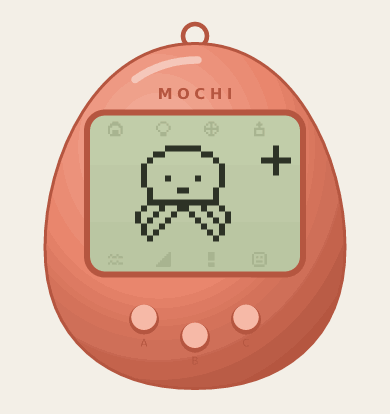
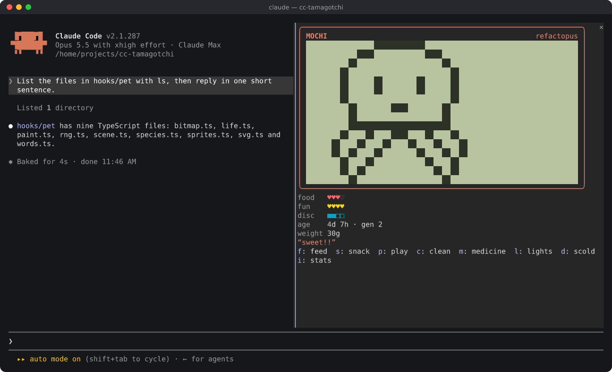
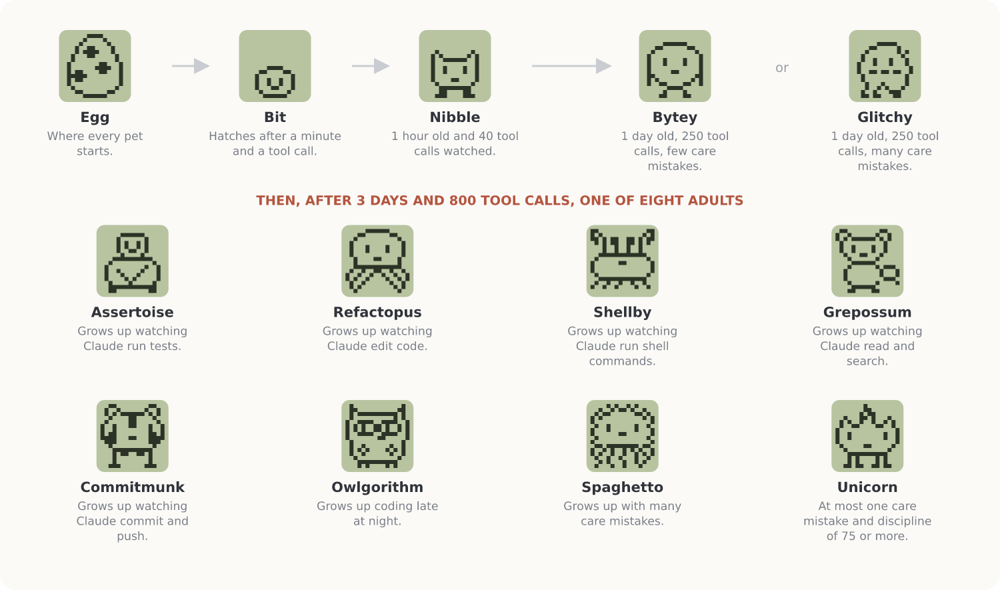
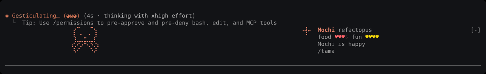
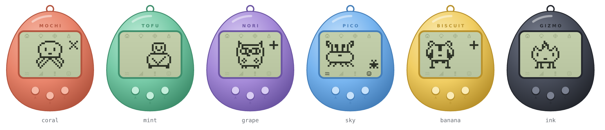

<div align="center">



# cc-tamagotchi

**A Tamagotchi that lives inside Claude Code.**<br>
It hatches when Claude gets to work, eats the code Claude writes, leaves bugs behind,<br>
gets sick, throws tantrums, and grows into one of eight adults depending on how you code.

[](https://github.com/davidurco/cc-tamagotchi/actions/workflows/test.yml)


</div>

```bash
claude plugin marketplace add davidurco/cc-tamagotchi
claude plugin install cc-tamagotchi@cc-tamagotchi
```

Then start `claude`. An egg appears. Type **`/tama`**.

<p align="center"></p>

## What it is

The first [Claude Code mod](https://code.claude.com/docs/en/plugins/mods/overview) that is a real virtual pet, not a status line. It lives in a pane beside your transcript, on a pixel LCD that animates on its own: it strolls about, blinks, naps, eats, and reacts to what Claude is doing right now.

- **It eats your work.** Every edit is a nibble. Passing tests make it cheer, and they squash a bug. Failing tests make a bug crawl out. A commit is a party.
- **It needs you.** Feed it, play with it, clean up its bugs, give it medicine, tuck it in, and discipline its tantrums. Ignore it and it remembers.
- **It grows into who you are.** Three days and 800 tool calls later it becomes one of eight adults, picked by how well you cared for it and what kind of work it watched.
- **It costs nothing.** No tokens: nothing it does reaches the model. No network, no files, no processes: just Claude Code's own store, clock and screen.
- **It is everywhere you look.** The device in a pane, the pet strolling above the prompt while Claude works, its face beside the spinner, its needs on the hint line. And in the desktop app, an egg-shaped device that animates as SVG.

## The life of a pet

<p align="center"></p>

| Stage | When it grows |
| --- | --- |
| **Egg** | Hatches a minute after it appears, at Claude's first tool call (or after three minutes) |
| **Bit** | After 1 hour and 40 tool calls |
| **Nibble** | After 1 day and 250 tool calls: few care mistakes make a **Bytey**, many a **Glitchy** |
| **Teen** | After 3 days and 800 tool calls, one of eight adults |

Which adult? Care comes first: a pet raised with at most one care mistake and firm discipline becomes the rare **Unicorn**, one raised with eight or more becomes **Spaghetto**. If you mostly code past 11 pm, it becomes an **Owlgorithm**. Otherwise it becomes what it watched Claude do most:

| It watched Claude… | It becomes |
| --- | --- |
| run tests | **Assertoise**, who carries the checkmark on its back |
| edit code | **Refactopus**, eight arms, eight files open |
| run shell commands | **Shellby**, who lives in the terminal |
| read and search | **Grepossum**, who finds what you lost |
| commit and push | **Commitmunk**, cheeks full of commits |

## Taking care of it

Open the device with `/tama`. Its buttons have hotkeys while the pane has the keyboard. Click the screen to pat your pet; after that click, the same keys work on the screen.

| Key | Command | What it does |
| --- | --- | --- |
| `f` | `/tama feed` | A meal: one heart of food, one gram |
| `s` | `/tama snack` | Candy: one heart of fun, two grams |
| `p` | `/tama play` | The left-or-right game. Guess which way it looks; win 3 of 5 |
| `c` | `/tama clean` | Squash the bugs it left behind |
| `m` | `/tama medicine` | Cure it when it is sick. Sometimes it takes two doses |
| `l` | `/tama lights` | Tuck it in (it sleeps through Claude's work), or wake it up |
| `d` | `/tama scold` | Discipline a tantrum. Never scold a pet that did nothing wrong |
| `i` | `/tama stats` | Its life in numbers, and what it is growing into |

What to know:

- **Food** empties in four awake hours, **fun** in five. Asleep, everything runs ten times slower.
- With **nothing going on for 20 minutes it naps**, and Claude's next tool call wakes it.
- **Bugs** show up about half an hour after a meal and now and then on their own. Leave them lying around and it gets **sick**.
- It **calls** you (`!` on the device, a line under the prompt) when it is hungry, bored, sick, buried in bugs, or throwing a **tantrum**. A call left unanswered for 15 awake minutes is a **care mistake**.
- In **classic** mode, half a day of hard neglect (starving and miserable, or sick) and it leaves for the cloud. It gets a place in the hall of fame (`/tama history`), and a new egg arrives (`/tama new`). Prefer it never leave? `/tama mode gentle`.
- Going away for a while? **`/tama vacation on`** stops its clock until you are back.

## While Claude works

<p align="center"></p>

Above the prompt, your pet strolls along a strip of braille dots while Claude works, and its face rides beside the spinner. When Claude is idle the strip folds into one line: face, name, meters, and whatever it is saying.

| Claude… | Your pet… |
| --- | --- |
| edits a file | nibbles the diff (+food) |
| runs tests that pass | cheers, and the tests squash a bug |
| runs tests that fail | a bug crawls out (−fun) |
| commits | throws a party (+fun, +food) |
| pushes | wheee |
| hits an error | flinches |

`/tama band auto` is the default. `band big` draws the strip in solid pixels (8 rows), `band on` keeps the strip up even when Claude is idle, `band line` keeps it to one line, and `band off` hides it.

## Six shells

<p align="center"></p>

`/tama shell coral` (the default), `mint`, `grape`, `sky`, `banana` or `ink`. In the terminal the shell is the device's frame; in the desktop app it is the whole egg.

## All commands

| Command | |
| --- | --- |
| `/tama` | Open or close the device (`/tamagotchi` works too) |
| `/tama feed · snack · play · clean · medicine · lights · scold · pat` | Take care of it |
| `/tama stats · history · help` | Its numbers, the pets before it, this list |
| `/tama name <name>` | Rename it |
| `/tama shell <color>` | coral, mint, grape, sky, banana, ink |
| `/tama band auto\|big\|on\|line\|off` | How it shows above the prompt |
| `/tama vacation on\|off` | Stop its clock while you are away |
| `/tama mode classic\|gentle` | Gentle: it never leaves, however neglected |
| `/tama spinner on\|off` | Its face beside the spinner |
| `/tama sound on\|off` | Beeps when it calls (played on the machine Claude Code runs on) |
| `/tama new · reset` | A new egg once it has left; start over (it asks first) |

Every command runs at once, even while Claude is working, and prints nothing into the conversation.

## Where it runs

| Where | What you get |
| --- | --- |
| `claude` in a terminal | Everything: the pixel LCD, the band, the spinner face, the hint line |
| The Code tab of the Claude desktop app | The device as an animated SVG, the band, buttons |
| The VS Code extension, `claude -p`, the Agent SDK | No drawing, but its life goes on: Claude's tool calls still feed it |

**One pet per machine.** Every session shares it through Claude Code's plugin store (`~/.claude/plugins/store/`). The simulation is deterministic, so all your sessions see the same pet, and work done in any of them feeds it.

## Is it safe?

A mod runs with your permissions, so check what one does before you install it. Claude Code lists what this one asks for without running it:

```bash
git clone https://github.com/davidurco/cc-tamagotchi
claude plugin validate ./cc-tamagotchi/.claude-plugin/plugin.json
```

```text
calls: $.audio.play, $.clock.after, $.clock.every, $.clock.now, $.command.register, $.state.get,
       $.state.set, $.store.get, $.store.set, $.ui.ask, $.ui.close, $.ui.invalidate, $.ui.log,
       $.ui.open, $.ui.panes, $.ui.resolve, $.ui.toast
```

No `$.fs`, `$.process`, `$.http` or `$.model`: it reads no files, runs nothing, sends nothing anywhere, and calls no model. It watches tool calls only to see what kind they were (an edit, a test run, a commit), and it never changes or blocks one.

## Requirements

Claude Code **v2.1.287** or later, where mods are on by default. Check with `claude --version`.

To try it without installing anything, load it from a clone for one session:

```bash
git clone https://github.com/davidurco/cc-tamagotchi
claude --plugin-dir ./cc-tamagotchi
```

## Development

```bash
claude --plugin-dir .            # loads the mod and reloads it on every save
claude plugin test .             # 39 tests, no session or network needed
claude plugin validate ./.claude-plugin/plugin.json
```

```text
hooks/
  register.tsx      the hooks module: events, /tama, the store, every drawing
  lcd.tsx           the terminal's screen: a Client that animates on the drawing thread
  pet/life.ts       the pet's life as pure functions: time, care, Claude's work, growth
  pet/scene.ts      what the screen shows at a moment, as a display list
  pet/sprites.ts    the pixel art: 1-bit sprites drawn as text
  pet/svg.ts        the desktop's animated device and strip
  pet/paint.ts      half blocks and braille for the terminal
types/index.d.ts    the $.state contract
tests/              claude plugin test
scripts/            the README's pictures, drawn from the mod's own code
```

Ideas, sprites and new adults are welcome. Open an issue or a pull request.

---

<sub>A fan project, not affiliated with or endorsed by Bandai or Anthropic. Tamagotchi is a trademark of Bandai. Made with Claude Code.</sub>
